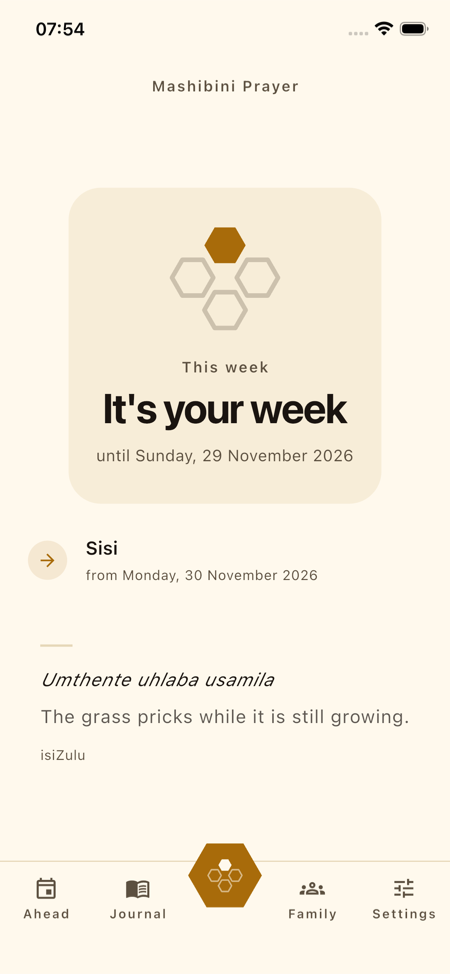
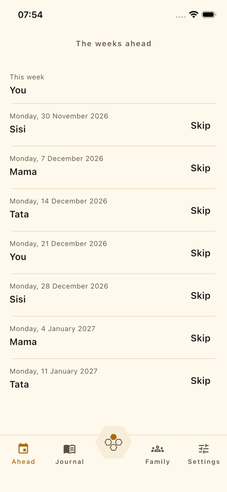
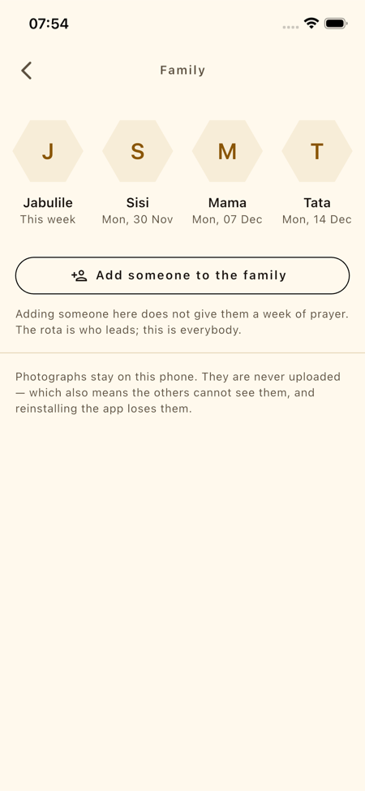
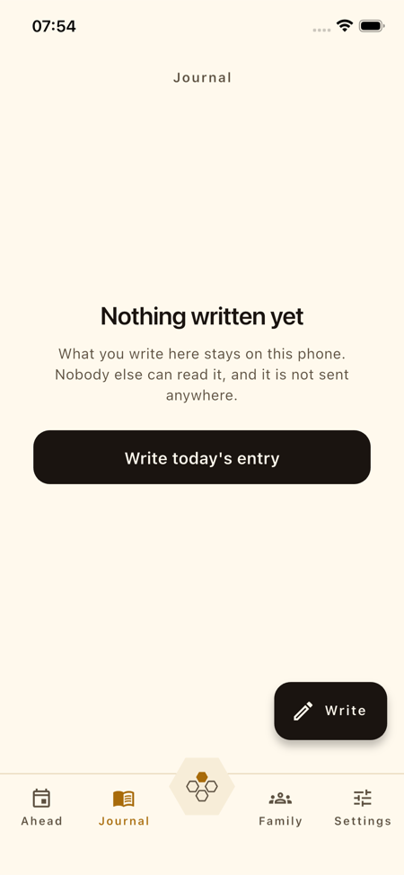
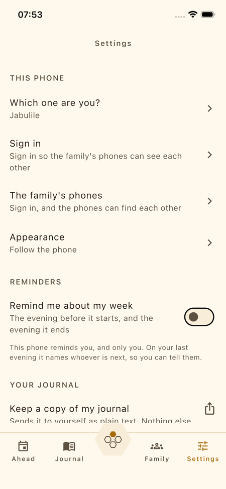

# Mashibini Prayer

A family keeps a prayer rota: each person takes a week to lead family prayer,
and when the last person's week ends it starts again. The rota lives in
everyone's head, which is why the handover gets remembered late.

This app holds the cycle, so nobody has to.

## What it looks like

| This week | The weeks ahead | The family |
|:--:|:--:|:--:|
|  |  |  |
| The answer, in the largest type on the screen. Who is next and when, and the saying for the day underneath | The next eight turns. Somebody away that week can be skipped, and the cycle keeps its rhythm | Everybody, in the order they lead. Photographs stay on the phone that chose them |

| The journal | Settings |
|:--:|:--:|
|  |  |
| What you prayed about. It is stored on this phone and sent nowhere — the empty state says so before you write anything | Who this phone belongs to, signing in, letting another phone into the family, and reminders |

> Screenshots are of the real app on an iPhone simulator, with a four-person
> rota set up through the setup screen. Nothing in them is a mock-up.

## What it does

Five tabs, with the answer in the middle.

| Tab | What it answers |
| --- | --- |
| **This week** | Whose week it is, who is next, and the day it changes hands |
| **Ahead** | The next eight turns, and skipping one when somebody is away |
| **Journal** | What you prayed about, private to the phone that wrote it |
| **Family** | Everybody in the family, and the songs they keep coming back to |
| **Settings** | Which one you are, reminders, signing in, the turnover day, the rota |

The rota is the product. Everything else sits around that answer.

### The parts worth knowing

**It works with no signal.** Whose week it is is counted from a stored anchor
date rather than fetched, so an aeroplane and a full signal give the same
answer. Nothing in the read path touches a network.

**The phones share one rota.** Sign in, and a change on one phone reaches the
others. Somebody already in the family has to let a new phone in by name —
there is no code or link that admits a stranger, which is why the family code
is safe to send over WhatsApp.

**Your journal is yours.** It is stored on the phone that wrote it and never
uploaded. Nobody else in the family can read it, and neither can we.

**A reminder reaches one phone, not four.** The evening before your week it
tells you; the evening it ends it names who is next, so you can tell them.
Reaching somebody who never opens the app needs a server, and this app
deliberately does not have one.

## Installing it

**Android 7.0 or newer.** The APKs are on the
[latest release](https://github.com/Jabulile1704/Mashibini-Prayer/releases/latest).
Take the one without a suffix — it is about a third of the size. If the phone
says *App not installed*, take `-any-phone` instead, which carries every kind
of processor.

**iOS** has no published build. A free Apple account signs an app for seven
days, after which it stops opening, so an iPhone needs it installed from
source about weekly.

## How this project is run

A small app built as though it were a production system, because the process
is half the point.

| Document | What is in it |
| --- | --- |
| [docs/CHARTER.md](docs/CHARTER.md) | Why it exists, who it is for, what is in and out of scope |
| [docs/REQUIREMENTS.md](docs/REQUIREMENTS.md) | Stories with acceptance criteria, non-functional requirements, open questions |
| [docs/adr/](docs/adr) | Every decision that was hard to reverse, and what it cost |
| [docs/daily/](docs/daily) | What happened each day, written at the end of it |
| [docs/RETROSPECTIVE.md](docs/RETROSPECTIVE.md) | What the method bought, and every defect that got past it |
| [docs/WORKFLOW.md](docs/WORKFLOW.md) | Branching model, commit convention, pull request rules |
| [docs/RELEASING.md](docs/RELEASING.md) | How a release is cut, and why it is cut from `main` |

Work is tracked as [issues](https://github.com/Jabulile1704/Mashibini-Prayer/issues).
Nothing reaches `main` except through a pull request with seven green checks,
and branch protection binds the owner too.

## Stack

Flutter and Dart in front, Firebase behind. The rota itself is pure Dart with
no I/O, so the part that has to be correct is tested without a device.

## Running it

```bash
flutter pub get
flutter test
flutter run
```

The security rules are tested against the Firestore emulator, which needs a
JDK:

```bash
dart run tool/emit_rules_fixture.dart
```

```bash
firebase emulators:exec --only firestore --project demo-mashibini "cd test/rules && npm test"
```
