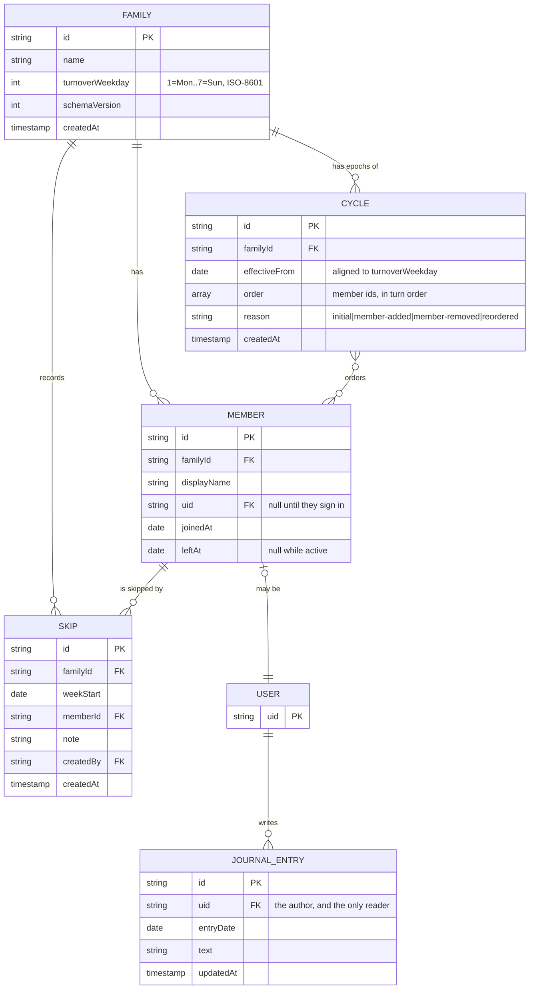

# Data model

> Phase 3. Every entity here traces to a requirement in
> [REQUIREMENTS.md](REQUIREMENTS.md). Anything that traced to nothing was cut
> before this document was written.

## The one idea the model is built on

**A turn is not stored. It is computed.**

The tempting model is a `currentLeader` field that something advances every
week. It is wrong, and it is wrong in a way that only shows up later: whatever
advances it has to run, and a phone that was off, or in a drawer for a month,
or reinstalled, gets a stale answer or a stampede of catch-up writes. Worse, it
cannot answer "who led in March?" at all.

So the database stores the **rules of the cycle**, and the leader for any date
is derived from them:

```
weekStart(d)      = the most recent turnoverWeekday on or before d
cycle             = the latest cycle whose effectiveFrom <= weekStart(d)
weekIndex(d)      = daysBetween(cycle.effectiveFrom, weekStart(d)) / 7
skipsBefore(d)    = skips in this cycle with weekStart <= weekStart(d)
position          = (weekIndex(d) + skipsBefore(d)) mod cycle.order.length
leader            = cycle.order[position]
```

Pure arithmetic over calendar dates. No clock to advance, nothing to catch up,
and six months in a drawer costs exactly one modulo (R1.3).

### Why skips add to the index

A skip moves the whole cycle forward by one rather than swapping two people.
Given the order A, B, C, D and A's week skipped:

| Week | Without skip | With A skipped |
|:--|:--|:--|
| W | A | **B** |
| W+1 | B | **C** |
| W+2 | C | **D** |
| W+3 | D | **A** |

A loses that turn and the rhythm continues. A is not owed a double turn later,
which is exactly what R1.4 asks for: a skip is forgiveness, not debt.

### Why the cycle is versioned

If the family changes — someone joins, someone leaves — the order length
changes, and a single stored order would silently rewrite history: every past
week would recompute against the new `n` and show the wrong person.

So a cycle is an **epoch**. Changing the family writes a *new* cycle with an
`effectiveFrom`, and old dates still resolve against the old epoch. Past turns
keep the names they actually had (R2.3), and the arithmetic above stays a
two-line function.

### Dates are dates, not instants

Every date in this model is stored as a plain `yyyy-mm-dd` string, never a
timestamp. A turnover is a *calendar* event — the week turns over on Sunday,
not at a particular microsecond — and storing an instant invites a timezone to
move it across a day boundary. The family's timezone is Africa/Johannesburg
with no daylight saving, so nothing bites today, but a member travelling is
enough to expose it. Timestamps are used only for audit fields (`createdAt`),
where the instant is the point.

## Entities



`TURN` is deliberately absent. It is a value the domain computes, not a row.

## Firestore layout

```
families/{familyId}                     one document, read on open
  ├── members/{memberId}
  ├── cycles/{cycleId}
  └── skips/{skipId}

journals/{uid}/entries/{entryId}        outside the family tree, on purpose

(verses are a bundled asset, not a collection — see below)
```

### Why journals sit outside the family tree

Privacy you have to remember to enforce is privacy you will eventually forget.
If entries lived at `families/{id}/members/{memberId}/journal/…`, every rule
and every query that widens to the family tree would be one mistake away from
exposing them.

Keyed by author at the root, the rule is one line and the denial is structural:

```
match /journals/{uid}/{document=**} {
  allow read, write: if request.auth.uid == uid;
}
```

Nothing a family-level query can do reaches it. That satisfies R4.2 and N3 by
construction rather than by vigilance. Written up as [ADR-004](adr/ADR-004-journals-outside-the-family-tree.md).

### Why verses are an asset, not a collection

They are the same for everyone, they never change, and they must be readable
with no connection (R3.1). A bundled `assets/verses.json` gives all three for
free. Selection is `daysSinceEpoch(date) % verses.length` — deterministic, so
every member sees the same verse on the same day with nothing coordinating
them.

The licence decides which translation can ship at all (R3.2, **Q2**), and that
is a blocker for Day 9, not a detail.

### Denormalisation, and the one place it is used

`cycles.order` holds member **ids** in turn order. One read of the current
cycle gives the whole rota, instead of reading every member document and
sorting them by a position field that could disagree with itself.

The cost is that order and membership can drift apart — an id in `order` that
no longer has a member document. The repository treats an unresolvable id as a
data defect, logs it and drops it from the cycle rather than crashing; the
rules require every id in `order` to exist at write time.

## Traceability

| Entity / field | Serves | Why it exists |
|:--|:--|:--|
| `family.turnoverWeekday` | R1.2, R2.2 | The day the week changes hands |
| `cycle.effectiveFrom` | R1.3, R2.2 | The anchor the whole computation counts from |
| `cycle.order` | R1.1, R1.2, R2.1 | Who leads, in what order |
| `cycle` as an epoch | R2.3 | Changing the family must not rewrite history |
| `skip` | R1.4 | A turn passed over, without owing a double turn |
| `member.displayName` | R1.1, R2.1 | The name on the screen |
| `member.uid` | R4.2, **Q3** | Ties a person to their journal, if they sign in |
| `member.leftAt` | R2.3 | Past turns still show the person who led them |
| `journalEntry` | R4.1, R4.3 | What you prayed about |
| `schemaVersion` | — | Lets a future migration know what it is looking at |

Nothing in the model exists without a line in this table. There is no `email`,
no `phone`, no `lastSeen`, no analytics identifier — N4 says collect only what
the app needs, and the app needs names and an order.

## Open question Q3, and what it changes

The model above assumes **each member signs in as themselves**. That assumption
is load-bearing for exactly one feature: journal privacy. If the family instead
shares one install:

- `member.uid` is null for everyone and `journals/{uid}` has no meaningful key
- R4.2 becomes unenforceable in the database — anyone holding the phone is
  every member at once
- The honest fallback is journals stored **only on the device**, never synced,
  with the privacy claim in the UI reduced to match

Everything else — the rota, the cycle epochs, the skips, the verse — works
identically either way. So Day 3 through Day 6 are not blocked by Q3, and the
decision is genuinely needed by Day 7.

## The test cases this model implies

The arithmetic above was executed before this document was merged, not just
reasoned about. Order A, B, C, D; turnover Sunday; `effectiveFrom` 2026-10-18.
Day 3 implements `leaderOn` and these become its unit tests:

| Case | Expectation | Why it matters |
|:--|:--|:--|
| No skips, six consecutive weeks | A, B, C, D, A, B | The ordinary case |
| A's first week skipped | B, C, D, A | The cycle moves on; A is not owed a double turn (R1.4) |
| Two skips in the same week | C, D, A, B | Two people away advances by two, not by one |
| All seven days of one week | the same leader for each | The turnover is a calendar boundary, not an hour (R1.2) |
| 26 weeks later, app untouched | `order[26 % 4]` | Six months in a drawer costs one modulo (R1.3) |
| Every week across ten years | `order[i % 4]` for all 521 | No drift, ever (R1.3) |
| A date before `effectiveFrom` | no leader | The rota did not exist yet — an error, not a guess |
| An id in `order` with no member | logged, dropped from the cycle | Denormalisation can drift; it must not crash |

## Schema versioning

`family.schemaVersion` starts at `1`. A change that cannot be read by an older
build increments it, and the migration is a documented, tested step in
`docs/adr/` — not something discovered by a crash report.
